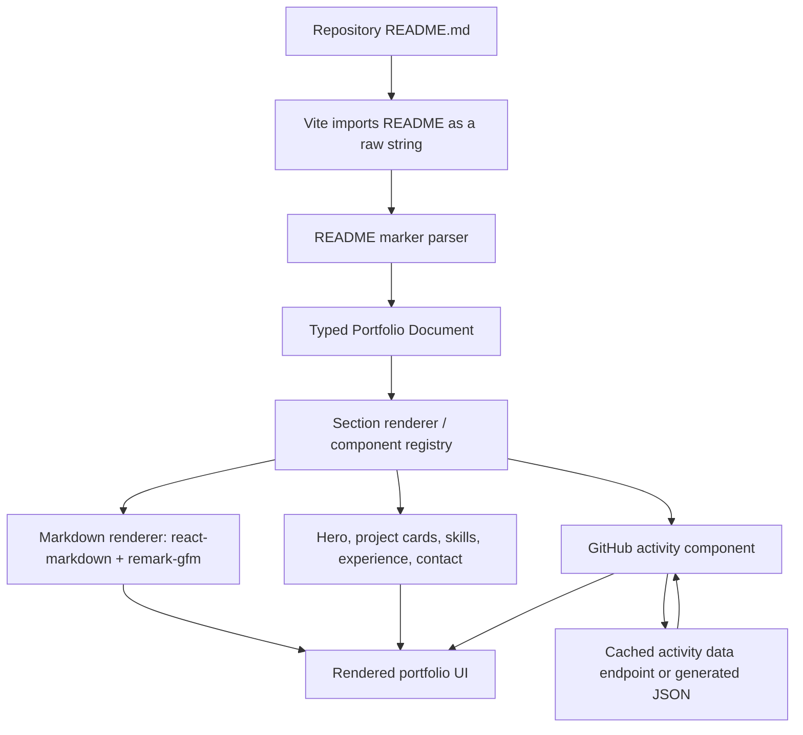

# README-Driven Portfolio Website — Architecture & Implementation Specification

**Status:** Implementation-ready design proposal  
**Primary goal:** Use the repository-root `README.md` as the main content source for a custom portfolio website.  
**Recommended stack:** React + TypeScript + Vite + `react-markdown` + `remark-gfm`.  
**Key constraint:** Keep the README readable and useful on GitHub while allowing the website to render custom React components.

---

## 1. Executive summary

Build a portfolio renderer rather than hand-maintaining the same content in React files and Markdown files.

The root `README.md` is the content source of truth. The website imports it as a raw string, interprets a small set of hidden HTML-comment markers, and turns the resulting document blocks into reusable React components. Each block's visible content remains normal Markdown and can be rendered on GitHub as a readable fallback.

Use:

- **Vite** to develop and build the React site.
- **TypeScript** for the parser, block types, component props, and API data contracts.
- **`react-markdown`** to render Markdown safely as React elements.
- **`remark-gfm`** to support GitHub Flavored Markdown features such as tables, strikethrough, task lists, and bare URLs.
- **A small custom README block parser** to identify portfolio sections and widgets. This is intentionally not a replacement Markdown parser; it only recognizes the project's documented comment markers.
- **Reusable React components** for the hero, project grid, skills, experience, GitHub contribution activity, and contact section.
- **A server-side or build-time GitHub data path** for contribution information. Never put a GitHub token in browser code.

The basic workflow becomes:

> Edit `README.md` → parse block markers → render the matching React components → build and deploy the portfolio.

Most content changes should not require touching application code. UI, animations, responsive behavior, and integrations remain in ordinary component files.

## 2. Goals and non-goals

### Goals

1. Keep `README.md` in the repository root as the main place to update portfolio copy and section order.
2. Keep the file valid, readable Markdown for GitHub's README renderer.
3. Use custom React components for visual sections, including project cards and a GitHub activity calendar.
4. Reuse one visual system rather than building a separate page layout for every section.
5. Validate content and fail with clear build errors when a marker is malformed.
6. Keep the first version small enough to implement incrementally.
7. Allow the website to degrade gracefully if GitHub activity data is unavailable.

### Non-goals for the first version

- Building a CMS or database for portfolio copy.
- Creating a general-purpose Markdown-to-website framework.
- Executing JSX, JavaScript, or arbitrary HTML from the README.
- Rebuilding GitHub's complete UI.
- Making all portfolio behavior configurable through Markdown.
- Fetching GitHub data on every page view without caching.
- Requiring a backend for ordinary README rendering.

## 3. Core design decisions

| Concern | Decision | Reason |
|---|---|---|
| Content source | Root `README.md` | One main content file and GitHub-compatible fallback |
| Frontend | React + TypeScript + Vite | Simple, fast client-side application with established tooling |
| Markdown renderer | `react-markdown` | Renders Markdown into React elements and supports component overrides |
| Markdown extensions | `remark-gfm` | Adds common GitHub Flavored Markdown syntax |
| Custom section syntax | HTML comments with JSON metadata | Hidden in normal GitHub rendering; easy to scan before Markdown rendering |
| Custom component mapping | Explicit registry keyed by section type | Keeps the parser separate from presentation |
| Project cards | Project item blocks with metadata and Markdown body | Rich UI without putting JSX in Markdown |
| GitHub activity | Separate data adapter + activity component | Separates data access from presentation |
| Styling | CSS variables/design tokens + component styles | Avoids mixing layout and design into Markdown |
| HTML policy | Do not enable raw HTML rendering for README content | Keeps the rendering pipeline safer and more predictable |
| Deployment | Static frontend; optional serverless function or scheduled data generation | README rendering itself does not require a backend |

## 4. System architecture



### Responsibility boundaries

**README** controls:
- The words people read.
- The links and image references.
- The order of portfolio sections.
- Project descriptions and optional project metadata.
- The presence of component blocks.

**Marker parser** controls:
- Recognizing the documented comment markers.
- Associating a body of Markdown with a section or item.
- Parsing and validating marker metadata.
- Returning a typed representation of the document.
- Producing understandable errors for malformed or unsupported structures.

**React component registry** controls:
- Which component renders each known block type.
- Which block props are accepted.
- How content is arranged into the design system.
- How unrecognized or ordinary Markdown blocks fall back to a generic Markdown renderer.

**Markdown renderer** controls:
- Converting normal Markdown into React nodes.
- Mapping basic elements such as headings, links, lists, and images to styled versions.
- Enabling GitHub Flavored Markdown through `remark-gfm`.

**Data integration layer** controls:
- Retrieving GitHub contribution data.
- Validating and normalizing API responses.
- Caching results and serving stale data when possible.
- Hiding credentials from the browser.

**Styles and design system** control:
- Typography, spacing, colors, borders, shadows, motion, responsive layouts, and focus states.
- No styling decisions should need to be repeated in README text.

## 5. Repository layout

A small, maintainable layout could look like this:

```text
portfolio/
├── README.md
├── index.html
├── package.json
├── tsconfig.json
├── vite.config.ts
├── public/
│   ├── images/
│   └── data/
│       └── github-activity.json       # optional, generated snapshot
├── src/
│   ├── main.tsx
│   ├── App.tsx
│   ├── vite-env.d.ts
│   ├── portfolio/
│   │   ├── readme-source.ts
│   │   ├── parse-portfolio.ts
│   │   ├── portfolio-types.ts
│   │   ├── validate-portfolio.ts
│   │   └── render-block.tsx
│   ├── components/
│   │   ├── markdown/
│   │   │   ├── MarkdownContent.tsx
│   │   │   └── markdown-components.tsx
│   │   ├── portfolio/
│   │   │   ├── HeroSection.tsx
│   │   │   ├── ProjectGrid.tsx
│   │   │   ├── ProjectCard.tsx
│   │   │   ├── SkillsSection.tsx
│   │   │   ├── ExperienceSection.tsx
│   │   │   ├── GitHubActivity.tsx
│   │   │   └── ContactSection.tsx
│   │   └── ui/
│   │       ├── Badge.tsx
│   │       ├── SectionHeading.tsx
│   │       └── ExternalLink.tsx
│   ├── services/
│   │   └── github-activity.ts
│   ├── styles/
│   │   ├── tokens.css
│   │   ├── global.css
│   │   └── portfolio.css
│   └── types/
│       └── github.ts
├── scripts/
│   ├── validate-readme.ts
│   └── generate-github-activity.ts  # optional for static snapshots
└── tests/
    ├── parse-portfolio.test.ts
    └── validate-portfolio.test.ts
```

Do not create all of these files before they are needed. For the first milestone, `README.md`, `parse-portfolio.ts`, `portfolio-types.ts`, `MarkdownContent.tsx`, `render-block.tsx`, a few portfolio components, and their styles are enough.

## 6. README authoring format

### 6.1 Design principles for markers

Use ordinary Markdown for content and a few HTML comments as control markers. The comments have no effect on normal GitHub Markdown rendering, but the website's parser can interpret them before passing the remaining Markdown to `react-markdown`.

Rules:

1. Each marker must be on its own line.
2. Marker metadata is valid JSON.
3. The parser recognizes only documented marker types.
4. The visible text between markers is Markdown, not JSX.
5. Do not put CSS, JavaScript, API credentials, or secrets in the README.
6. Every section and item marker must have a matching closing marker.
7. IDs must be unique within the document.
8. Section order in the README is section order on the website.
9. Do not rely on arbitrary HTML being rendered by either GitHub or the portfolio.
10. Keep enough human-readable text in each block so the GitHub README remains useful on its own.

### 6.2 Proposed marker grammar

Section start:

```html
<!-- portfolio:section {"id":"intro","type":"hero"} -->
```

Section end:

```html
<!-- portfolio:endsection -->
```

Item start, used inside supported collection sections such as a project grid:

```html
<!-- portfolio:item {"id":"oden","type":"project","featured":true,"repo":"https://github.com/kaiju-no-9/oden","stack":["TypeScript","Bun"]} -->
```

Item end:

```html
<!-- portfolio:enditem -->
```

The parser treats the JSON after the marker name as metadata. The closing marker contains no metadata. Keep the grammar deliberately small and document any new block type before using it.

### 6.3 Example root README

The following is a starting template. Replace, add, or remove sections as your portfolio evolves.

```md
<!-- portfolio:section {"id":"intro","type":"hero"} -->
# Nishchay Kumar

AI + Full-stack Engineer building developer tools, AI systems, and useful products.

[GitHub](https://github.com/kaiju-no-9) ·
[LinkedIn](https://www.linkedin.com/in/nishchay-kumar-63bb92325/) ·
[Email](mailto:nishchaykumar89@gmail.com)
<!-- portfolio:endsection -->

<!-- portfolio:section {"id":"featured-projects","type":"project-grid","title":"Selected Projects","columns":2} -->
## Selected Projects

<!-- portfolio:item {"id":"oden","type":"project","featured":true,"repo":"https://github.com/kaiju-no-9/oden","stack":["TypeScript","Bun","LLM tools"]} -->
### Oden

A model-agnostic terminal coding and research harness for multi-step agent workflows.

- **Focus:** agent orchestration, tool execution, safety, and evaluation.
- **Source:** [GitHub repository](https://github.com/kaiju-no-9/oden)
<!-- portfolio:enditem -->

<!-- portfolio:item {"id":"dictator","type":"project","featured":true,"repo":"https://github.com/kaiju-no-9/Dictator","stack":["TypeScript","AI","video tooling"]} -->
### Dictator

An AI-assisted video editor exploring transcript and scene analysis, edit planning, and validated timelines.

- **Focus:** multimodal workflows and structured output validation.
- **Source:** [GitHub repository](https://github.com/kaiju-no-9/Dictator)
<!-- portfolio:enditem -->

<!-- portfolio:item {"id":"grabpic","type":"project","featured":true,"repo":"https://github.com/kaiju-no-9/GrabPic","demo":"https://grabpic.framer.ai/","stack":["AI search","Full-stack"]} -->
### GrabPic

An AI-powered photo search experience for event attendees.

- **Focus:** search UX, backend reliability, and user-facing AI features.
- **Source:** [GitHub repository](https://github.com/kaiju-no-9/GrabPic) · **Demo:** [Try it](https://grabpic.framer.ai/)
<!-- portfolio:enditem -->
<!-- portfolio:endsection -->

<!-- portfolio:section {"id":"skills","type":"skills","title":"Tools I Use"} -->
## Tools I Use

- **Languages:** TypeScript, Go, Python
- **Frontend:** React, Svelte, HTML, CSS
- **Backend and data:** Node.js, FastAPI, SQL
- **AI engineering:** LLM APIs, tool calling, RAG, evaluation workflows
<!-- portfolio:endsection -->

<!-- portfolio:section {"id":"github-activity","type":"github-activity","username":"kaiju-no-9"} -->
## GitHub Activity

Explore my public repositories and contribution history on [GitHub](https://github.com/kaiju-no-9).
<!-- portfolio:endsection -->

<!-- portfolio:section {"id":"contact","type":"contact"} -->
## Contact

For engineering opportunities and collaborations: [nishchaykumar89@gmail.com](mailto:nishchaykumar89@gmail.com).
<!-- portfolio:endsection -->
```

### 6.4 Why the comments are useful

GitHub displays the normal Markdown between the comments and omits the comments themselves from the rendered page. The website reads the raw source, recognizes the comments, and wraps each block in a designed component.

The exact same file therefore has two renderers:

- GitHub uses its own Markdown renderer and displays the visible prose.
- Your portfolio uses the custom marker parser plus `react-markdown` and displays the prose inside a custom layout.

This does **not** make GitHub render the custom website components. It only makes the content compatible with both renderers.

## 7. Dependencies and project setup

Create a React + TypeScript + Vite project:

```bash
npm create vite@latest portfolio -- --template react-ts
cd portfolio
npm install
npm install react-markdown remark-gfm
npm install -D vitest @testing-library/react @testing-library/jest-dom
```

Use `npm run dev` to develop and `npm run build` to verify the production build. The exact scripts are created by the Vite template; add testing and validation scripts as the project grows.

### Importing the README as a raw string

Vite's `?raw` import returns a file's contents as a string. If `src/App.tsx` sits one directory below the repository root, use:

```tsx
import readmeSource from '../README.md?raw';
```

Ensure Vite's client types are included, usually through `src/vite-env.d.ts`:

```ts
/// <reference types="vite/client" />
```

Do not fetch the README from the public GitHub URL at runtime. Importing it from the repository makes the deployed site use the same version that was built and avoids an extra network request.

## 8. Typed document model

Use a typed intermediate representation between the raw README and the React components. That makes parsing, validation, and rendering separate concerns.

A starting type model:

```ts
export type PortfolioSectionType =
  | 'markdown'
  | 'hero'
  | 'project-grid'
  | 'skills'
  | 'experience'
  | 'github-activity'
  | 'contact';

export interface PortfolioItem {
  id: string;
  type: 'project';
  metadata: Record<string, unknown>;
  markdown: string;
}

export interface PortfolioSection {
  id: string;
  type: PortfolioSectionType;
  metadata: Record<string, unknown>;
  markdown: string;
  items?: PortfolioItem[];
}

export interface PortfolioDocument {
  blocks: PortfolioSection[];
}
```

Refine `Record<string, unknown>` into explicit discriminated metadata types as the project stabilizes. For example, a project item should eventually have a validated `repo`, `stack`, optional `demo`, optional `image`, and optional `featured` field.

## 9. Parser design

### 9.1 Important distinction

**Do not write a replacement Markdown parser.** `react-markdown` already parses Markdown. The custom parser only recognizes the project's line-based HTML-comment markers and extracts content blocks.

The parser should be deterministic and intentionally limited. It should not evaluate arbitrary code or attempt to infer custom components from every heading.

### 9.2 Parsing algorithm

1. Receive the raw README string.
2. Split the input into lines while preserving line breaks when rebuilding content.
3. Scan for a recognized `portfolio:section` start marker.
4. Parse its JSON metadata and validate the required `id` and `type`.
5. Collect ordinary Markdown lines until the matching end-section marker or a supported item marker is found.
6. If the section is a collection such as `project-grid`, extract each item block and preserve its Markdown body.
7. Reject mismatched markers, duplicate IDs, malformed JSON, unsupported types, or unsupported nesting with a clear error message.
8. Return an ordered `PortfolioDocument`.
9. Render each block using the component registry.

The first version can support these grammar rules only:

- Sections cannot be nested inside sections.
- Items can only appear inside a section type that explicitly supports items.
- Items cannot be nested inside other items.
- Every open marker must be closed.
- Unknown component types fail validation rather than silently rendering an empty block.

### 9.3 Marker recognition

Use anchored, line-based patterns for the marker lines. Example patterns for a first implementation:

```ts
const SECTION_START = /^\s*<!--\s*portfolio:section\s+(\{.*\})\s*-->\s*$/;
const SECTION_END = /^\s*<!--\s*portfolio:endsection\s*-->\s*$/;
const ITEM_START = /^\s*<!--\s*portfolio:item\s+(\{.*\})\s*-->\s*$/;
const ITEM_END = /^\s*<!--\s*portfolio:enditem\s*-->\s*$/;
```

These patterns are only for recognizing your own marker lines. Parse the captured metadata with `JSON.parse`, then validate the result. Do not use these expressions to parse Markdown syntax itself.

### 9.4 Parsing and rendering pseudocode

```ts
const document = parsePortfolioDocument(readmeSource);
validatePortfolioDocument(document);

return (
  <main className="portfolio-page">
    {document.blocks.map((block) => (
      <PortfolioBlock key={block.id} block={block} />
    ))}
  </main>
);
```

The implementation of `parsePortfolioDocument` should be a simple state machine, not one giant regular expression. Keep error messages specific, such as:

- `README.md: line 42: invalid JSON in portfolio:item metadata`
- `README.md: line 58: portfolio:enditem found without an open item`
- `README.md: duplicate block id "projects"`
- `README.md: type "timeline-widget" is not registered`

### 9.5 Handling text outside custom sections

For the cleanest first version, keep all portfolio content inside explicit sections. Optionally, support text outside markers as a generic `markdown` block. If this feature is implemented, preserve the text's original position in the document so the website order continues to match the README.

## 10. Rendering the typed document

Create one renderer that maps known types to React components:

```tsx
import type { PortfolioSection } from './portfolio-types';
import { MarkdownContent } from '../components/markdown/MarkdownContent';
import { HeroSection } from '../components/portfolio/HeroSection';
import { ProjectGrid } from '../components/portfolio/ProjectGrid';
import { SkillsSection } from '../components/portfolio/SkillsSection';
import { GitHubActivity } from '../components/portfolio/GitHubActivity';
import { ContactSection } from '../components/portfolio/ContactSection';

export function PortfolioBlock({ block }: { block: PortfolioSection }) {
  switch (block.type) {
    case 'hero':
      return <HeroSection block={block} />;
    case 'project-grid':
      return <ProjectGrid block={block} />;
    case 'skills':
      return <SkillsSection block={block} />;
    case 'github-activity':
      return <GitHubActivity block={block} />;
    case 'contact':
      return <ContactSection block={block} />;
    case 'experience':
    case 'markdown':
      return <MarkdownContent markdown={block.markdown} />;
    default: {
      const exhaustiveCheck: never = block.type;
      return exhaustiveCheck;
    }
  }
}
```

This is a structural example, not a complete copy-paste implementation: the exact TypeScript exhaustiveness pattern depends on the final type definitions. Ensure the final `switch` compiles cleanly and does not use `any` to bypass type errors.

### 10.1 Render Markdown content

```tsx
import Markdown from 'react-markdown';
import remarkGfm from 'remark-gfm';
import { markdownComponents } from './markdown-components';

export function MarkdownContent({ markdown }: { markdown: string }) {
  return (
    <div className="markdown-content">
      <Markdown remarkPlugins={[remarkGfm]} components={markdownComponents}>
        {markdown}
      </Markdown>
    </div>
  );
}
```

### 10.2 Map basic elements to design-system components

`react-markdown` supports overriding the React components used for Markdown elements. Use this for consistent headings, links, blockquotes, images, and lists.

Example:

```tsx
import type { Components } from 'react-markdown';

export const markdownComponents: Components = {
  h1({ node, children, ...props }) {
    return <h1 className="markdown-h1" {...props}>{children}</h1>;
  },
  h2({ node, children, ...props }) {
    return <h2 className="markdown-h2" {...props}>{children}</h2>;
  },
  a({ node, href, children, ...props }) {
    const isExternal = Boolean(href?.startsWith('https://') || href?.startsWith('http://'));
    return (
      <a
        href={href}
        className="markdown-link"
        {...(isExternal ? { target: '_blank', rel: 'noreferrer noopener' } : {})}
        {...props}
      >
        {children}
      </a>
    );
  },
};
```

Treat this as a starting point. Review the exact TypeScript props supported by the installed `react-markdown` version. For links, make sure the final component preserves the package's safe URL handling and does not allow dangerous URL protocols.

### 10.3 Component rendering strategy

- `HeroSection`: displays the introductory Markdown in a designed hero layout. Keep one semantic page-level `h1`.
- `ProjectGrid`: lays out each parsed project item in a responsive grid.
- `ProjectCard`: displays its title, description, stack badges, repository link, and optional demo/image.
- `SkillsSection`: uses either ordinary Markdown lists or a normalized list of skill groups.
- `ExperienceSection`: renders a chronological list or timeline. Use Markdown in the first version if advanced structured metadata is unnecessary.
- `GitHubActivity`: fetches or receives normalized activity data and renders the contribution grid.
- `ContactSection`: renders email and social links, with accessible labels.

Avoid a component that attempts to handle every section type through dozens of conditions. One small renderer and focused components are easier to maintain.

## 11. Project card data model

The project item metadata should supply information that is hard to infer reliably from prose. The Markdown body supplies the human-readable description and fallback display.

Suggested project fields:

```ts
export interface ProjectMetadata {
  id: string;
  type: 'project';
  repo: string;
  stack: string[];
  featured?: boolean;
  demo?: string;
  image?: string;
  status?: 'active' | 'complete' | 'archived';
}
```

Validation rules:

- `id` is required and unique.
- `repo` must be a valid `https://github.com/...` URL.
- `stack` is an array of short strings.
- `demo` and `image` are optional and must use allowed URL formats.
- Do not invent statistics such as user counts, stars, or performance improvements.
- Do not make a card depend on a live GitHub request just to display its title and description.

If project metadata becomes too verbose, move only the structured data to YAML or JSON files. The README can still determine section placement. However, for the initial version, keeping a modest amount of metadata in comment markers is acceptable and avoids maintaining two project lists.

## 12. GitHub contributions and activity

### 12.1 Keep data retrieval separate from rendering

The `GitHubActivity` component should not contain GraphQL request code, secrets, or API response parsing. It should consume a normalized data structure, for example:

```ts
export interface ContributionDay {
  date: string;              // YYYY-MM-DD
  count: number;
  level: 0 | 1 | 2 | 3 | 4;
}

export interface GitHubActivityData {
  username: string;
  totalContributions: number;
  weeks: ContributionDay[][];
  updatedAt: string;
}
```

The adapter transforms the upstream GitHub response into this application-owned format. This makes the React component easy to test and means the data source can be changed without rewriting the UI.

### 12.2 Choose one data strategy

**Option A — generated JSON snapshot (simplest static deployment)**

- Run a script during deployment or on a scheduled GitHub Actions workflow.
- The script calls GitHub's GraphQL API using a CI secret.
- Normalize the result and write `public/data/github-activity.json`.
- The website fetches that public JSON file.
- Schedule a rebuild/deploy daily or weekly to refresh the snapshot.

Advantages: the deployed site remains static; no serverless request is needed for visitors. Trade-off: the data refreshes only when the workflow runs.

**Option B — cached serverless endpoint (better for more frequent updates)**

- Add a serverless function such as `/api/github/activity` on the chosen hosting platform.
- The function calls GitHub GraphQL with a server-only token.
- Cache the normalized response, for example for 1 hour, and reuse stale data when GitHub is temporarily unavailable.
- The browser calls your endpoint, not GitHub directly with credentials.

Advantages: fresher data without a full site rebuild. Trade-off: requires a serverless deployment feature and cache/error handling.

**Option C — unauthenticated public REST data (limited scope)**

- Public REST endpoints can provide recent public repository events.
- They are not a drop-in replacement for the full contribution calendar.
- Unauthenticated REST requests have a rate limit, so do not issue repeated requests per render.

### Recommendation

Start with **Option A, a generated JSON snapshot**, if a static hosting workflow is the priority. It keeps the first release low-complexity and protects the token. Move to Option B only if frequent updates become important.

### 12.3 GraphQL data source

GitHub's GraphQL API exposes a `contributionsCollection` with a `contributionCalendar`, including the total contribution count, weeks, days, counts, dates, and contribution levels.

Conceptual query shape:

```graphql
query ContributionCalendar($login: String!, $from: DateTime!, $to: DateTime!) {
  user(login: $login) {
    contributionsCollection(from: $from, to: $to) {
      contributionCalendar {
        totalContributions
        weeks {
          contributionDays {
            date
            contributionCount
            contributionLevel
            color
          }
        }
      }
    }
  }
}
```

Confirm the exact schema and allowed arguments against the current GitHub GraphQL documentation when implementing. The adapter should map the API's contribution levels to the local `0`–`4` display scale and should not assume color values remain constant.

### 12.4 Token security

- Keep the token in a GitHub Actions secret or a server-only environment variable.
- Never use a `VITE_` environment variable for a secret; Vite exposes `VITE_` variables to browser code.
- Never commit a token in `README.md`, source code, generated client bundles, or public JSON.
- Request only the permissions needed for the chosen query and data visibility.
- If only public data is required, do not request access to private repositories unnecessarily.
- On an API error, render a stable fallback and a link to the user's GitHub profile.

### 12.5 Activity component UX

- Include an accessible section heading.
- Provide a text alternative or summary of the total contributions.
- Give each day a tooltip or accessible label with its date and count.
- Do not rely on color alone; use a readable label for contribution intensity.
- Handle loading, empty, stale, and error states.
- Make the grid usable at narrow viewport widths, either by controlled horizontal scrolling or a responsive layout.
- Include a link to the full GitHub profile/contribution graph.

## 13. Styling architecture

The Markdown should not be responsible for CSS. Use design tokens and scoped component styles.

Example tokens:

```css
:root {
  --color-bg: #0b0d10;
  --color-panel: #12161c;
  --color-text: #f5f7fa;
  --color-muted: #a4adb8;
  --color-border: #28303a;
  --color-accent: #8bc5ff;

  --space-1: 0.25rem;
  --space-2: 0.5rem;
  --space-3: 0.75rem;
  --space-4: 1rem;
  --space-6: 1.5rem;
  --space-8: 2rem;

  --radius-card: 1rem;
  --content-width: 72rem;
}
```

These are example tokens, not mandatory design decisions. Choose the actual palette and typography when designing the website.

Design requirements:

- Use one content-width system and consistent spacing.
- Make the project grid responsive.
- Include keyboard-focus styles on every interactive element.
- Respect `prefers-reduced-motion` for animations.
- Use semantic HTML and a logical heading hierarchy.
- Avoid layout shifts when images and activity data load.
- Keep Markdown default styles scoped to `.markdown-content` so they do not leak into unrelated components.
- Keep custom animations in components, never as executable Markdown content.

## 14. Security and content handling

`react-markdown` is secure by default when used as intended and does not require injecting raw HTML with `dangerouslySetInnerHTML`. Preserve that behavior.

Rules:

1. Do not enable `rehype-raw` for README content in the first version.
2. Do not use `dangerouslySetInnerHTML` to render the README.
3. Keep the `react-markdown` URL transformation secure. Do not add support for dangerous protocols such as `javascript:`.
4. Validate URLs in metadata; only allow `https:` for repositories, demos, and external images, plus `mailto:` for email links where appropriate.
5. Treat marker JSON as untrusted input for validation purposes even if the repository is private to the project owner.
6. Never turn marker metadata into code, an import path, a component name to dynamically import, or arbitrary CSS.
7. Map a finite set of known block types to components in a static registry.
8. If content could be edited by untrusted contributors, add schema validation and consider a sanitization policy for allowed Markdown features.
9. Never expose API secrets in `README.md`, built JavaScript, client-visible environment variables, or logs.

The section-marker parser is not a security boundary by itself. It is a small content parser. The safety boundary is the combination of constrained metadata, safe Markdown rendering, safe URL handling, and server-only secrets.

## 15. Validation and build checks

Create a validation command that runs before production builds.

Validate:

- Every marker opens and closes correctly.
- Marker JSON is valid.
- Block and item IDs are unique.
- Required metadata fields are present and correctly typed.
- Only registered section and item types are used.
- Items only appear in compatible sections.
- Repository URLs and external links use allowed protocols.
- The hero has one clear primary heading.
- Project cards have a title, description, repository link, and stack when required.
- The GitHub activity section has a username or a documented default.
- Referenced local images exist.

Suggested package scripts after implementing the commands:

```json
{
  "scripts": {
    "dev": "vite",
    "build": "tsc -b && vite build",
    "preview": "vite preview",
    "test": "vitest run",
    "test:watch": "vitest",
    "portfolio:validate": "tsx scripts/validate-readme.ts",
    "check": "npm run portfolio:validate && npm run test && npm run build"
  }
}
```

This is a proposed script set. Install `tsx` if using it to execute a TypeScript validation script, or compile/run the script using your existing TypeScript tooling. Preserve any scripts already created by the Vite template.

## 16. Testing strategy

### Parser unit tests

- Parses a valid hero section.
- Parses a project grid and multiple project items.
- Preserves the section order from README.
- Preserves Markdown line breaks and links.
- Rejects invalid JSON metadata.
- Rejects an end marker without a corresponding start marker.
- Rejects an unclosed section/item.
- Rejects duplicate IDs.
- Rejects an unknown component type.
- Rejects items outside a compatible section.

### Component tests

- A project card displays its title, description, stack, repository, and optional demo link.
- A Markdown link is rendered as a link with the expected destination.
- A normal Markdown table and task list are rendered through `remark-gfm`.
- GitHub activity supports loading, success, empty, and error states.
- The website remains readable when contribution data is unavailable.

### Integration/build tests

- The deployed app includes the same README content version used during the build.
- The document validates before the production build.
- No GitHub secret appears in the generated JavaScript or `dist/` files.
- Images and links work after deployment to the actual base path/domain.
- Responsive and keyboard-accessibility checks pass on the hero, project grid, and activity grid.

## 17. Performance, caching, and failure modes

- Importing README with `?raw` embeds its contents during the build, so no runtime fetch is needed for portfolio copy.
- Keep the marker parser synchronous, deterministic, and lightweight.
- Avoid unnecessary dependencies for basic README parsing.
- Lazy-load non-critical visualizations only if they materially affect initial loading.
- Give images explicit dimensions or aspect ratios to prevent layout shifts.
- Cache GitHub data separately from Markdown rendering.
- Display the last known activity snapshot if a refresh fails.
- Avoid retry loops when GitHub reports a rate limit.
- Do not block the entire portfolio page on a third-party API response.
- If an unsupported marker is present, fail validation during CI or show a clear development error rather than silently omitting a section.

## 18. SEO and accessibility

For a portfolio that is mostly a static React/Vite SPA, basic metadata is still important, but client-side rendering can be less robust for some crawlers than server-rendered HTML. Start with title, description, canonical URL if one is configured, Open Graph metadata, a favicon, and a sitemap if appropriate. If search visibility becomes a priority, consider pre-rendering the portfolio HTML at build time without changing the README-first content architecture.

Accessibility requirements:

- Exactly one primary `h1` for the page.
- Correct section heading hierarchy.
- Descriptive link labels rather than repeated “click here” text.
- Useful alternative text for meaningful images; empty alt for purely decorative images.
- Visible keyboard focus and working keyboard navigation.
- Adequate contrast for all text and contribution levels.
- Respect reduced-motion preferences.
- Screen-reader-accessible values for contribution cells.

## 19. Deployment model

### Frontend

Build the application with `npm run build` and deploy the static `dist/` output to a static host such as Vercel, Netlify, Cloudflare Pages, or GitHub Pages. Configure the correct base path if deploying under a subpath.

### GitHub activity snapshot

If using Option A:

1. Store the token as a GitHub Actions secret.
2. Execute a server-side script in the workflow.
3. Query and normalize GitHub activity.
4. Write a JSON file into the public data directory before the frontend build.
5. Build and deploy the site.
6. Schedule the workflow to refresh it periodically, or refresh when useful changes happen.

If using Option B, deploy an API/serverless function alongside the static frontend and configure server-only environment variables in the hosting platform. A plain static host alone cannot safely hold a secret or run a server endpoint.

### Continuous integration

On pull requests and pushes:

1. Install dependencies using the lockfile.
2. Run README validation.
3. Run unit tests.
4. Run TypeScript checks and the production build.
5. Deploy only after all checks pass.

## 20. Implementation phases

### Phase 1 — Basic rendering

- Create Vite + React + TypeScript project.
- Install `react-markdown` and `remark-gfm`.
- Import the root README as a raw string.
- Render standard Markdown with a custom `components` map.
- Add basic page styles.

**Exit criteria:** README content renders correctly on the website and continues to look readable in GitHub.

### Phase 2 — Marker parser and component registry

- Finalize marker grammar.
- Implement the parser as a state machine.
- Add strict metadata validation and useful line-numbered errors.
- Add typed block models.
- Add the component registry and render sections in document order.

**Exit criteria:** Changing section order in README changes the website order without editing the React page component.

### Phase 3 — Projects and portfolio sections

- Implement hero, project grid, project card, skills, experience, and contact components.
- Add project item metadata.
- Make all components responsive and accessible.
- Keep copy and links in README rather than duplicating them in JSX.

**Exit criteria:** A new project can be added using the documented README format without building a new UI component.

### Phase 4 — GitHub activity

- Choose generated JSON snapshot or cached serverless endpoint.
- Implement the GitHub data adapter.
- Normalize the result into the local activity type.
- Add the calendar, accessible labels, and error states.
- Store credentials only in server/CI secrets.

**Exit criteria:** Contribution data loads when available, does not block the rest of the page, and never exposes the secret in client assets.

### Phase 5 — Validation and release workflow

- Add parser and component tests.
- Add README validation to CI.
- Add metadata, accessibility, and responsive checks.
- Confirm deployed image paths and URLs.
- Write a short contributor guide explaining how to edit the README safely.

**Exit criteria:** Invalid markers cause an actionable check failure; content edits are repeatable and do not require risky manual changes to React code.

## 21. Definition of done

The first production-ready version is complete when:

- [ ] The root `README.md` is the primary content source.
- [ ] The file remains readable on GitHub.
- [ ] The website imports it as a string through Vite.
- [ ] The site renders Markdown through `react-markdown` and `remark-gfm`.
- [ ] Supported comment markers produce typed blocks and custom components.
- [ ] The parser rejects malformed metadata and mismatched markers.
- [ ] Section order follows the README.
- [ ] Project cards can be added or edited from README content and metadata.
- [ ] GitHub activity uses a separate adapter and safe, cached data strategy.
- [ ] GitHub credentials are not present in browser code or public files.
- [ ] All page sections are responsive and accessible.
- [ ] Tests, validation, and production build pass in CI.
- [ ] An API failure never breaks the whole portfolio.

## 22. Known limitations and trade-offs

1. **README comment markers are custom conventions.** GitHub does not know about your portfolio components; only your own parser does.
2. **The README is imported at build time.** Editing it requires a new build/deployment to update the live website.
3. **Markdown is not a full page-layout language.** Keep complex layout and animation behavior in React components.
4. **Metadata inside comments is less discoverable than visible Markdown.** Document the syntax and validate it automatically.
5. **Project card structure needs a contract.** Avoid trying to infer all metadata from arbitrary prose; use explicit item metadata for fields that affect UI.
6. **GitHub activity requires a data strategy.** The full contribution calendar generally needs authenticated GraphQL access or a generated/cached data source; do not assume a public events endpoint provides the full calendar.
7. **This is not a live CMS.** Content updates happen through commits and deployments. That is a feature if you prefer Git-based version control, but not if you want non-technical editing in a dashboard.

## 23. Official references

Use these as the primary documentation while implementing:

- [`react-markdown` repository and documentation](https://github.com/remarkjs/react-markdown) — Markdown rendering, component overrides, plugin support, URL handling, and security guidance.
- [`remark-gfm` repository](https://github.com/remarkjs/remark-gfm) — GitHub Flavored Markdown support.
- [Vite static asset handling](https://vite.dev/guide/assets) — importing a file as a string with the `?raw` suffix.
- [GitHub GraphQL `Users` documentation](https://docs.github.com/en/graphql/reference/users) — `contributionsCollection` and contribution calendar fields.
- [GitHub REST API rate limits](https://docs.github.com/en/rest/using-the-rest-api/rate-limits-for-the-rest-api) — API rate-limit behavior and authenticated versus unauthenticated access.

Check the current versions of the official documentation before implementing details that may vary by dependency version.

---

## Final recommendation

Implement the portfolio in this order:

1. **Make `README.md` render through `react-markdown` first.** Confirm that normal Markdown is good before building custom behavior.
2. **Add the comment-marker parser second.** Keep its job limited to splitting content into typed blocks; do not make it parse Markdown itself.
3. **Add a small component registry and reusable cards.** The README supplies content and ordering; React supplies design.
4. **Add GitHub activity as an isolated integration.** Prefer a generated JSON snapshot for the simplest static deployment, then upgrade to a cached endpoint only when needed.
5. **Add validation and tests early.** A README-driven system is maintainable when a typo produces a useful error rather than a broken or missing section.

This gives you the GitHub README-inspired editing workflow while retaining the freedom to build a distinctive, fully styled portfolio. The content stays in Markdown; the UI stays in React; live data stays in a separate, testable integration.
